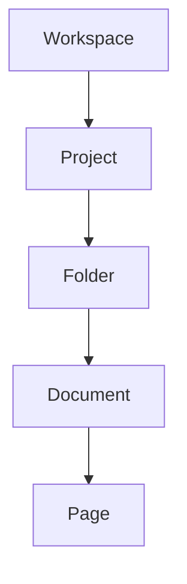

## Overview

Newby Enterprises provides powerful tools for managing your documentation. You organize content into structured hierarchies, track changes with version history, collaborate securely, and find information quickly using search and tags.

<Columns cols={3}>
  <Card title="Document Hierarchy" icon="layers" href="#document-hierarchy">
    Build nested folder structures for large projects.
  </Card>
  <Card title="Version Control" icon="git-branch" href="#version-control">
    Track every change with full history.
  </Card>
  <Card title="Collaboration" icon="users" href="#collaboration">
    Share and manage permissions easily.
  </Card>
</Columns>

<Callout kind="tip">
  Start with a simple workspace and expand as your projects grow.
</Callout>

## Document Structuring and Hierarchies

Create organized spaces for your documentation using workspaces, projects, folders, and documents. This hierarchy keeps content intuitive and scalable.



<Steps>
  <Step title="Create Workspace" icon="home">
    Navigate to your dashboard and click `New Workspace`.
  </Step>
  <Step title="Add Project" icon="folder">
    Inside the workspace, select `New Project` and name it, such as `API Docs`.
  </Step>
  <Step title="Organize Folders" icon="package">
    Create folders like `Endpoints` and `Guides` within the project.
  </Step>
</Steps>

## Version Control and History Tracking

Every edit creates a new version. You view, compare, and restore previous states without losing work.

<CodeGroup tabs="CLI,API">
  ````bash
  newby version list --project api-docs
  newby version restore v1.2.3
  ````
  ````javascript
  const versions = await newby.versions.list({ project: 'api-docs' });
  await newby.versions.restore('v1.2.3');
  ````
</CodeGroup>

<Expandable title="Compare Versions" default-open="true">
  Use the UI diff viewer to spot changes:

  | Aspect       | V1.2.3          | V1.2.4          |
  |--------------|-----------------|-----------------|
  | Lines Added  | 0               | 15              |
  | Lines Removed| 5               | 2               |
  | Author       | you@example.com | team@example.com|
</Expandable>

## Collaboration and Sharing Permissions

Invite team members and set granular permissions: view, edit, or admin.

<Tabs>
  <Tab title="Invite User" icon="user-plus">
    ````bash
    newby collab invite user@example.com --role editor --project api-docs
    ````
  </Tab>
  <Tab title="Set Permissions" icon="shield">
    ````javascript
    await newby.permissions.update({
      project: 'api-docs',
      user: 'user@example.com',
      role: 'editor'
    });
    ````
  </Tab>
</Tabs>

<Callout kind="alert">
  Always review permissions before sharing public links.
</Callout>

## Search and Tagging Functionalities

Tag documents for quick filtering and use full-text search across your workspace.

<Steps>
  <Step title="Add Tags" icon="tag">
    Edit a document and add tags like `api`, `v1`, `internal`.
  </Step>
  <Step title="Search" icon="search">
    Use the search bar: `tag:api v1` to find relevant docs.
  </Step>
</Steps>

| Search Type | Example Query     | Results Example          |
|-------------|-------------------|--------------------------|
| Full-text   | `authentication`  | 25 matching documents    |
| Tag-based   | `tag:api`         | 12 API-related pages     |
| Advanced    | `from:team v1`    | 8 results from team, v1  |

These features help you maintain efficient documentation workflows. Explore the [quickstart](/quickstart) for hands-on setup.